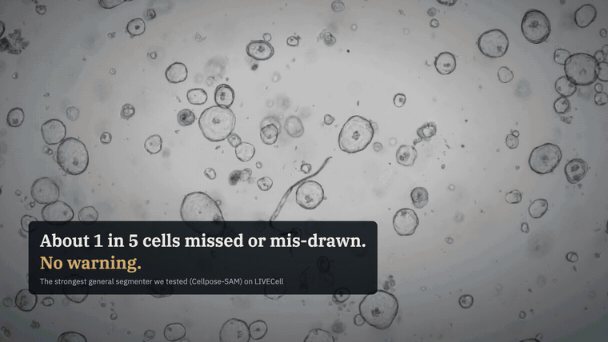
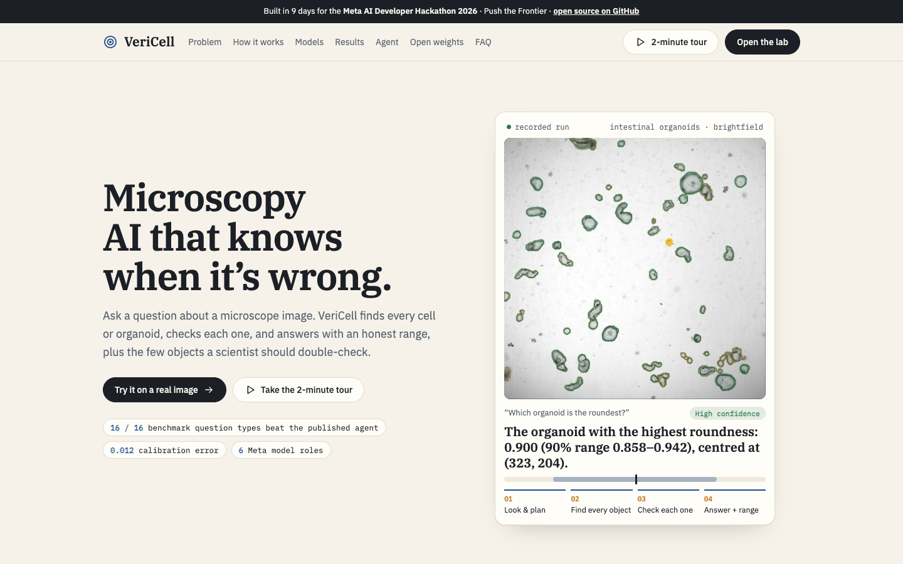
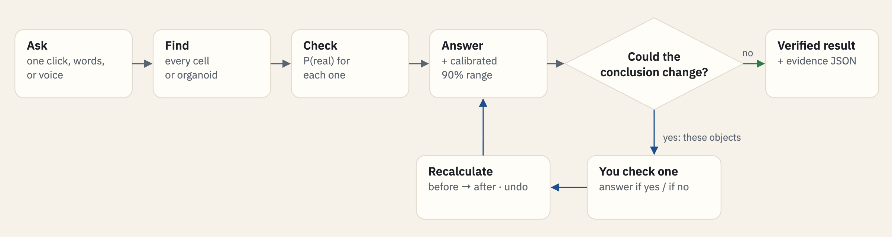
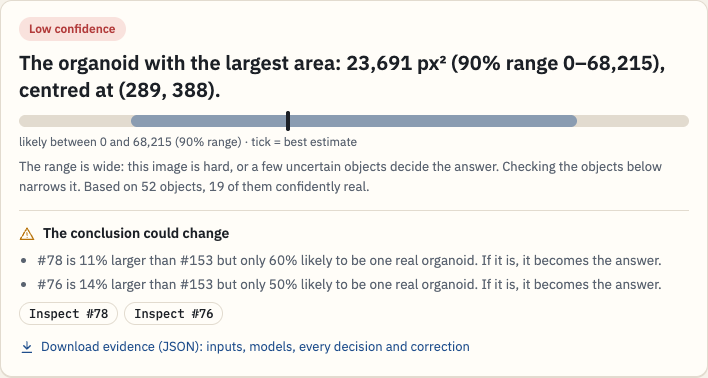
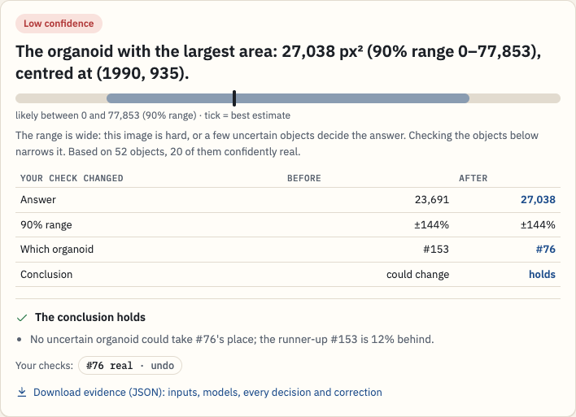
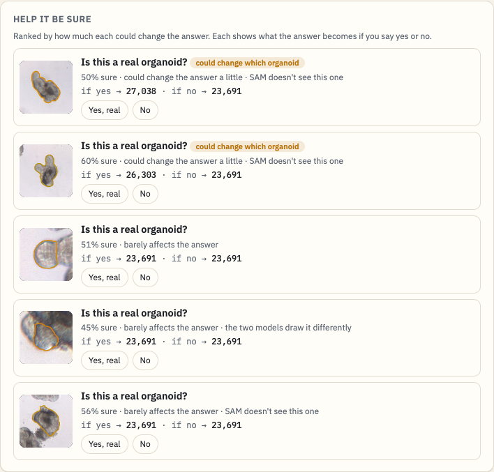
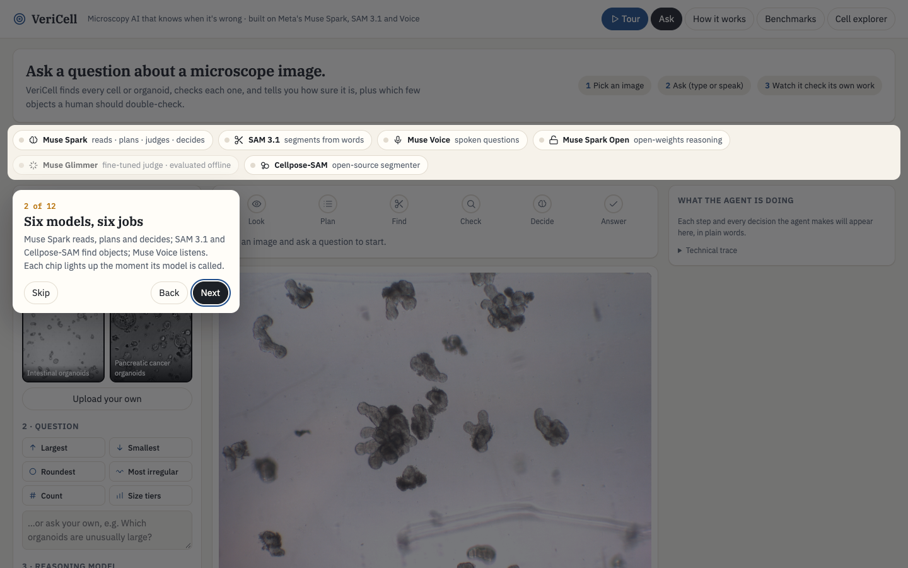
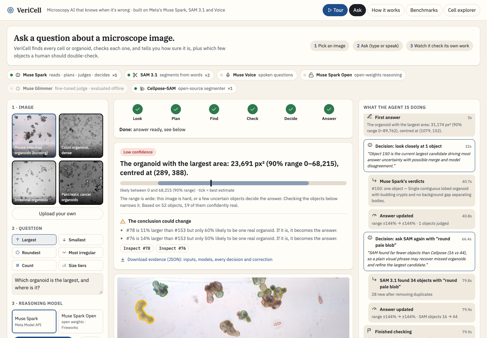
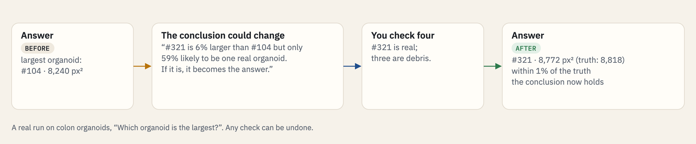
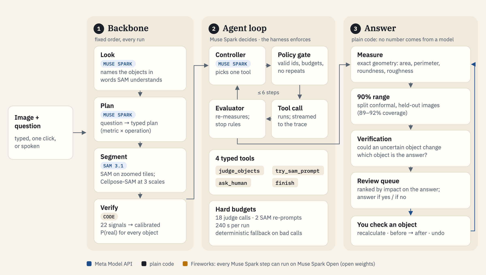

> **Provenance:** built from scratch during the Meta AI Developer Hackathon, Oct 26 – Nov 4, 2026; nothing pre-existing.
> **Runtime Meta stack:** Muse Spark 1.3 · SAM 3.1 · Muse Voice Transcribe · Muse Spark Open (16/16 plans on open weights) · Muse Glimmer 30B (fine-tune experiment).
> **Bonus categories:** Best Agentic Use-Case · Best Build on Meta Open Weight Models.
> **Demo video:** [watch the 2:32 walkthrough](https://youtu.be/QWMNuQcAVDs). **Try it, no setup:** [2-minute guided tour on a real image](https://pranavdaware1-1--vericell-web.us-east.modal.run/app?tour=1).

<div align="center">


# VeriCell

### Microscopy AI that knows when it's wrong.

Ask a question about a microscope image. VeriCell finds every cell or organoid, **checks each one**,
answers with an **honest 90% range**, tells you **whether the conclusion itself could change**, and
points at the few objects a scientist should double-check.

[](https://github.com/dawarepranav/VeriCell/actions/workflows/tests.yml)
[](LICENSE)
[](pyproject.toml)
[](https://youtu.be/QWMNuQcAVDs)
[](https://pranavdaware1-1--vericell-web.us-east.modal.run)
[](https://huggingface.co/datasets/pranavdaware/vericell-results)

**[Watch the demo](https://youtu.be/QWMNuQcAVDs)** ·
**[Live demo](https://pranavdaware1-1--vericell-web.us-east.modal.run)** ·
**[2-minute guided tour](https://pranavdaware1-1--vericell-web.us-east.modal.run/app?tour=1)** ·
[Results](RESULTS.md) · [Architecture](docs/ARCHITECTURE.md) · [Dataset](https://huggingface.co/datasets/pranavdaware/vericell-results)

Built for the **Meta AI Developer Hackathon 2026** (Push the Frontier) on
**Muse Spark · SAM 3.1 · Muse Voice Transcribe · Muse Spark Open · Muse Glimmer**.

<a href="https://youtu.be/QWMNuQcAVDs"></a>

<sub><b>▶ Click to watch the full 2:32 demo on YouTube.</b> A real run on the live site, with sound.</sub>

</div>

<picture>
  <source media="(prefers-color-scheme: dark)" srcset="docs/images/landing-dark.png">
  
</picture>

## At a glance

| Claim | Evidence |
|---|---|
| **Beats the published agent** | Lower median error than MorphoOrgaAgent on **16 / 16** question types of the MorphoOrgaVQA organoid benchmark |
| **Knows its own mistakes** | Spots wrong cells with AUROC **0.866** (SAM 3.1's own confidence: 0.823); per-cell confidence calibrated to ECE **0.012** |
| **Honest ranges** | 90% answer ranges contain the truth **89–92%** of the time on held-out images, for every question type |
| **Says which conclusions to trust** | When VeriCell says a "largest organoid" conclusion holds, it's right **87%** of the time (20 of 23, within 15% of the truth). When it warns, the answer is nearly **4× as likely** to be wrong: 49% vs 13%. The warning catches **83%** of wrong size conclusions ([RESULTS.md §6](RESULTS.md)) |
| **Measured SAM 3.1 vocabulary** | "organoid" alone gets F1 **0.00** from SAM; measured prompts take held-out organoid F1 from 0.441 to **0.575** and cut "SAM finds nothing" from **10 to 1** of 34 images ([§7](RESULTS.md)) |
| **Checks the conclusion, not just the masks** | Finds the uncertain object that would change *which* organoid is the answer, and shows the answer before and after you check it |
| **Stress-tests claims** | Finds the fewest uncertain objects that would break a claim: on a real run, "largest area at most 36,000 px²" is **1-organoid fragile** (#150, 62% likely real) |
| **Open weights** | Every reasoning step runs on hosted Muse Spark or **Muse Spark Open** on Fireworks, with the same benchmark answers |

> Research images only, never diagnosis. Every line of code in this repository was written during the hackathon.

---

## The problem

Almost every measurement in cell biology starts with **segmentation**: AI drawing the outline of each
cell or organoid. Drug screens, cancer and organoid research, and neuroscience imaging all measure
counts, sizes and shapes from those outlines.

- **Errors are silent.** The strongest general segmenter we tested, Cellpose-SAM, misses or mis-draws
  about **1 in 5 cells** on LIVECell, with no warning.
- **Checking by hand doesn't scale.** One image can hold hundreds of objects (ours reach about 690).
- **No error bars.** "The largest organoid is 31,000 px²" comes with no range, so a reader can't tell a
  solid number from a lucky guess, or know whether one bad outline flipped the result.

Recent microscopy agents (MorphoOrgaAgent 2026, GenCellAgent 2025, napari-chatgpt/Omega) answer
questions in plain English, but none checks each object, gives calibrated confidence, or says when the
conclusion is fragile.

## The loop

<picture>
  <source media="(prefers-color-scheme: dark)" srcset="docs/images/diagram-loop-dark.png">
  
</picture>

1. **Ask** with one click (largest, smallest, roundest, most irregular, count, size tiers), in your own
   words, or by voice (Muse Voice Transcribe).
2. **Watch the agent work**: Look → Plan → Find → Check → Decide → Answer, with every decision in its own
   words. Chips count each Meta model call live.
3. **Get the answer with a 90% range** and a verdict: *does the conclusion hold, and which objects could change it?*
4. **Check the objects that matter.** Each one shows the answer if it's real and if it's not. One click
   recalculates and shows a before/after table; any check can be undone.
5. **Stress-test a claim**, e.g. *"the largest organoid is at most 36,000 px²"*: VeriCell searches for the fewest
   uncertain objects that would break it and reports **"1-organoid fragile"** or **robust**.
6. **Plan re-imaging**: the spots that could change the conclusion, marked on the image, as a
   Pycro-Manager z-stack script for a real microscope (a plan you calibrate and run; VeriCell never drives hardware).
7. **Download the evidence** as JSON: inputs, models, every decision and every correction.

## See it

<table>
<tr>
<td width="50%"><b>Answer-aware verification</b><br/>
<picture>
  <source media="(prefers-color-scheme: dark)" srcset="docs/images/verify-dark.png">
  
</picture></td>
<td width="50%"><b>What-if: your check changes the conclusion</b><br/>
<picture>
  <source media="(prefers-color-scheme: dark)" srcset="docs/images/whatif-dark.png">
  
</picture></td>
</tr>
<tr>
<td><b>Review queue, ranked by impact on the answer</b><br/>
<picture>
  <source media="(prefers-color-scheme: dark)" srcset="docs/images/review-dark.png">
  
</picture></td>
<td><b>Guided tour on a real run</b><br/>
<picture>
  <source media="(prefers-color-scheme: dark)" srcset="docs/images/tour-dark.png">
  
</picture></td>
</tr>
</table>

<details>
<summary><b>The whole lab</b></summary>

<picture>
  <source media="(prefers-color-scheme: dark)" srcset="docs/images/lab-dark.png">
  
</picture>
</details>

## Answer-aware verification

A low-confidence outline only matters if it can change the scientific answer. So for "most extreme"
questions VeriCell asks, from the same per-object probabilities that drive the range:

- **Challengers:** which uncertain objects would *become* the answer if confirmed real?
- **Successor:** which object takes over if the current answer isn't real?
- **Near ties:** is the runner-up within 5%, so a small outline error could swap them?

On a real run (colon organoids, *"Which organoid is the largest?"*):

> *#321 is 6% larger than #104 but only 59% likely to be one real organoid. If it is, it becomes the answer.*

The claim "the largest organoid is at most 9,000 px²" comes back **1-organoid fragile**. Four checks later
(#321 is real; #470, #299 and #150 are not), the answer moves from 8,240 px² to **8,772 px²**, the verdict
changes from *could change* to *holds*, and the claim is **robust**. Hand-measured truth: **8,818 px²**, so
the answer went from 7% off to within 1%. Any check can be undone.

<picture>
  <source media="(prefers-color-scheme: dark)" srcset="docs/images/diagram-verify-dark.png">
  
</picture>

## How it works

A fixed backbone does the heavy work, **Muse Spark decides only where judgement is needed**, and
**no number ever comes from a model**: measurement, ranges, verification and the review ranking are plain code.

<picture>
  <source media="(prefers-color-scheme: dark)" srcset="docs/images/diagram-arch-dark.png">
  
</picture>

### Six models, six jobs

| Model | Provider | Role in VeriCell |
|---|---|---|
| **Muse Spark 1.3** | Meta Model API | Reads the image, plans the question, judges doubtful crops, controls the agent |
| **SAM 3.1** | Meta Model API | Segments from a phrase; zoom-tiling took dense-image F1 from 0.27 to **0.82** |
| **Muse Voice Transcribe** | Meta Model API | Spoken questions |
| **Muse Spark Open** | Fireworks AI | The whole reasoning layer on open weights, one switch away |
| **Muse Glimmer 30B** (fine-tuned) | Fireworks AI | LoRA crop-judge experiment; reported below, not used in production |
| **Cellpose-SAM** | open source | Generalist segmenter, run at three scales so big organoids fit |

### Harness engineering

The agent is a harness around the model: Muse Spark proposes one action at a time; code checks, runs,
measures and records it. The design follows Anthropic's *Building effective agents* and 2026 bio-agent work.

| Principle | How VeriCell applies it |
|---|---|
| Fixed backbone, agency only where needed | Look, plan, segment, verify always run in order; the model decides only in the repair loop |
| Typed, small toolset | 4 tools with strict JSON schemas: `judge_objects` (≤ 6 ids), `try_sam_prompt` (1–5 words), `ask_human` (≤ 5 ids), `finish` |
| Policy gate between request and execution | Rejects unknown tools, ids that don't exist, repeats, and over-budget calls; falls back to a deterministic policy |
| Hard budgets | 6 controller steps, 18 crop-judge calls, 2 SAM re-prompts, 240 s per run |
| Evaluator after every action | Answer and range recomputed; stop when the range is within ±10%, no object can move it by 2%, or two actions don't help |
| Compact state, never raw data | The controller sees the plan, answer, range, top uncertain objects and budget left; never masks |
| Human as a tool, tied to evidence | `ask_human` hands specific objects to the review queue, ranked by impact on the answer |
| Full trace | Every step, argument, reason and effect is streamed to the UI, saved per run, and exported as evidence |

In real runs: on a dense colon image SAM found 0 objects for "organoid"; the controller reasoned that the
biology word mismatched, re-prompted with *"small round blobs"* and recovered 181 objects.

## Results

All numbers are out-of-fold (no image is scored by a model trained on it). Full tables, methods and
caveats: [RESULTS.md](RESULTS.md). Raw numbers: [Hugging Face dataset](https://huggingface.co/datasets/pranavdaware/vericell-results).

**MorphoOrgaVQA** (68 organoid images × 16 questions), median error, lower is better:

| Question | MorphoOrgaAgent (published) | Cellpose-SAM | **VeriCell** |
|---|---:|---:|---:|
| Area of the largest organoid | 16.8% | 4.9% | **3.6%** |
| Area, three-tier means | 38.7% | 32.6% | **28.1%** |
| Perimeter of the longest | 15.4% | 9.6% | **7.3%** |
| Perimeter, three-tier means | 22.0% | 19.5% | **16.5%** |
| Roundness of the roundest | 1.54% | 1.57% | **1.38%** |
| Roundness, three-tier means | 2.48% | 2.05% | **2.03%** |
| Roughness of the roughest | 46.0% | 50.2% | **38.9%** |
| Roughness, three-tier means | 31.8% | 28.3% | **23.8%** |

| Other results | Value |
|---|---|
| Muse Spark planner picks the right analysis | **16/16** questions (Muse Spark Open: 16/16) |
| Organoid segmentation F1 vs Cellpose-SAM | **0.672** vs 0.596 |
| Spotting wrong cells on LIVECell (AUROC) | **0.866** vs 0.823 for SAM 3.1's own confidence |
| Confidence calibration on LIVECell (ECE) | **0.012**: "80% sure" ≈ right 80% of the time |
| F1 after a human checks the 12.5% least-certain cells | 0.851 → **0.880** |
| 90% answer ranges containing the truth, held-out images | **89–92%** for every question type |

### Open weights: Muse Spark Open on Fireworks AI

One switch (`VERICELL_LLM=open`, or the toggle in the lab) runs every reasoning step on
`accounts/fireworks/models/muse-spark-open`.

| Check | Hosted Muse Spark 1.3 | Muse Spark Open |
|---|---|---|
| Planner, 16 benchmark questions | 16/16 | **16/16** |
| Planner wall time, 16 questions | 33 s | **21 s** (low reasoning effort) |
| Crop judge, 80 labelled crops | 72% | 70% |
| Agent controller, same state | judges object #150 | same decision, same reasoning |

### What didn't work (reported on purpose)

| Tried | Result | Why |
|---|---|---|
| Fusing Cellpose + SAM on LIVECell | F1 0.851 vs Cellpose 0.857 | Recall rose, precision fell; the gain on cells is *knowing which are wrong* |
| Muse Spark crop judge ("one organoid or several?") | 72% hosted, 70% open | Lobes and cavities read as separate bodies; ground truth itself merges touching organoids |
| Showing the judge 6 labelled example crops | −7 points hosted, −1 open | Too few examples for an ambiguous task |
| **Fine-tuned Muse Glimmer 30B** judge (LoRA SFT, 3 runs) | 57%, 61%, 61% vs 72% | v1 learned "joined outline = several"; harder examples fixed part of it, more capacity didn't |
| Calibrated 90% ranges | Right coverage, but wide on hard images | Errors are heavy-tailed: about 1 image in 10 fails badly |

## Quickstart

```bash
git clone https://github.com/dawarepranav/VeriCell && cd VeriCell
make setup                  # Python 3.11 virtualenv (PyTorch for Cellpose has no 3.15 build yet)
cp .env.example .env        # add META_API_KEY (and optionally FIREWORKS_API_KEY)
make smoke                  # checks Muse Spark, SAM 3.1 and Voice Transcribe with your key
make serve                  # http://localhost:8765  (landing page; the lab is at /app)
```

Or with Docker: `docker compose up` (reads `.env`; keys are never baked into the image).

| Command | What it does |
|---|---|
| `make test` | 31 unit tests, no API calls (also run in CI) |
| `make data` | LIVECell sample (24 images) + MorphoOrgaVQA rebuilt from its 3 source datasets |
| `make benchmark` | LIVECell verifier results and the full MorphoOrgaVQA run |
| `make models` | trains the deployable verifiers and calibrates the answer ranges |
| `make serve-open` | the web app with every reasoning step on Muse Spark Open |
| `.venv/bin/python scripts/ask.py IMAGE "QUESTION"` | the agent from the command line |

<details>
<summary><b>HTTP API</b></summary>

| Endpoint | What it does |
|---|---|
| `POST /api/ask` | image (or example name) + question → the agent's steps as server-sent events; the last carries the answer |
| `POST /api/review` | `{session, object_id, real}` marks an object real / not real; `real: null` undoes it |
| `POST /api/audit` | `{session, op: "at_most" \| "at_least", threshold}` → fewest uncertain objects that break the claim, or robust |
| `GET /api/session/{id}/reimage` | objects that could change the conclusion, with positions and a Pycro-Manager script (never executed) |
| `GET /api/session/{id}/evidence` | JSON evidence: question, plan, models, answer, range, verification, corrections, judge verdicts, trace |
| `POST /api/transcribe` | audio → text (Muse Voice Transcribe) |
| `GET /api/examples` | the demo images |
</details>

<details>
<summary><b>Deploy your own public demo (Modal)</b></summary>

```bash
python scripts/build_space.py                          # bundles the app with cached examples
modal secret create vericell-keys --from-dotenv .env
modal deploy deploy/modal_app.py
```

Demo mode (`VERICELL_DEMO=1`) serves only the cached examples, caps asks at 40 per hour and turns off uploads.
</details>

## Repository layout

| Path | Contents |
|---|---|
| `vericell/agent.py` | agent harness: backbone, controller loop, policy gate, evaluator, fallback, verification, evidence |
| `vericell/answers.py` | answers, calibrated ranges, and answer stability (challengers, successor) |
| `vericell/llm.py` | one interface to Muse Spark (Meta API) or Muse Spark Open (Fireworks) |
| `vericell/planner.py`, `judge.py` | scene description, question planner, crop judge |
| `vericell/sam.py`, `proposers.py` | SAM 3.1 client (zoom-tiling, parallel calls), Cellpose-SAM pyramid |
| `vericell/features.py`, `verifier.py` | 22 verification signals, calibrated verifier, fusion |
| `vericell/measure.py` | measurement engine (matches MorphoOrgaVQA's formulas exactly) |
| `vericell/web/` | FastAPI app, landing page and lab |
| `scripts/` | data, benchmarks, training, calibration, evaluation, Glimmer fine-tuning, deploy |
| `tests/` | unit tests |

## Scope and honesty

VeriCell is for **research images only, never diagnosis**. The organoid benchmark was rebuilt as 68
images (the paper used 69 and doesn't list its files). Benchmark ground truth keeps debris that its
source dataset filters out; official numbers are the headline, and a debris-filtered view is reported
separately in [RESULTS.md](RESULTS.md).

## Credits

Meta (Muse Spark, Muse Spark Open, Muse Glimmer, SAM 3.1, Muse Voice Transcribe), Fireworks AI
(open-weights inference and fine-tuning), Modal (demo hosting), Cellpose-SAM (Stringer & Pachitariu),
MorphoOrgaVQA / MorphoOrgaAgent (Zhang & Hoermann), and the LIVECell, OrganoID, OrgaSegment and
OrgaExtractor datasets. [MIT license](LICENSE).
