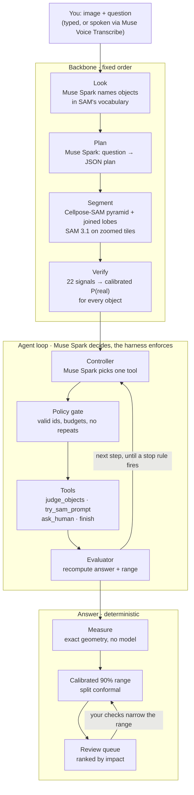

# VeriCell: microscopy AI that knows when it's wrong

Ask a question about a microscope image, by typing or speaking. VeriCell finds every cell or
organoid, **checks each one**, fixes what it can, and answers with an **honest 90% range** plus the
few objects a human should double-check.

Built for the **Meta AI Developer Hackathon 2026** (Cerebral Valley, Oct 27 – Nov 4) on Meta's models:
**Muse Spark** (reasoning and planning), **SAM 3.1** (segmentation), **Muse Voice Transcribe** (spoken
questions), and **Muse Spark Open** on **Fireworks AI** (open-weights mode). All code in this repository
was written during the hackathon; nothing was pre-existing.

**Live demo: <https://pranavdaware1-1--vericell-web.us-east.modal.run>** (hosted on Modal; public demo
mode with four example images. The first visit after idle takes ~30 s to wake up.)

[](https://github.com/dawarepranav/VeriCell/actions/workflows/tests.yml)
· Track: Push the Frontier · Results: [RESULTS.md](RESULTS.md) · Data: [Hugging Face dataset](https://huggingface.co/datasets/pranavdaware/vericell-results) · Design: [docs/ARCHITECTURE.md](docs/ARCHITECTURE.md)

---

## The problem

Almost every measurement in cell biology starts with **segmentation**: AI drawing the outline of each
cell or organoid. Drug screens, cancer and organoid research, and neuroscience imaging all measure
counts, sizes and shapes from those outlines.

- **Errors are silent.** The strongest general segmenter we tested, Cellpose-SAM, misses or mis-draws
  about **1 in 5 cells** on a standard dataset (LIVECell), with no warning.
- **Checking by hand doesn't scale.** One image can hold hundreds of objects (ours reach about 690).
- **No error bars.** "The largest organoid is 31,000 px²" comes with no range, so nobody can tell a
  solid number from a lucky guess.

Recent microscopy agents (MorphoOrgaAgent 2026, GenCellAgent 2025, napari-chatgpt/Omega) answer
questions in plain English, but none checks each object or gives calibrated confidence.

## What VeriCell does

1. **Pick an image and ask**, e.g. *"Which organoid is the largest, and where is it?"*, typed or spoken.
2. **Watch the agent work**, step by step: Look → Plan → Find → Check → Decide → Answer. Its decisions
   appear with its reasoning, e.g. *"SAM found 0 objects versus 285 from Cellpose, so the prompt may not
   match the biology word; trying 'small round blobs'"*.
3. **Get an answer with a range**, e.g. *"Largest organoid: 31,174 px² (90% range 27,038–54,540)"*, with
   a High / Medium / Low confidence badge.
4. **Answer a few questions** ("Is this a real organoid?") about the objects that matter most. The
   answer and its range update instantly.
5. **Switch the reasoning model** between hosted Muse Spark and **Muse Spark Open (open weights)**.

## Architecture



- **Muse Spark decides only where judgement is needed:** reading the image, planning, judging
  doubtful crops, and choosing the agent's next action. **No number is ever produced by a model**:
  measurement, ranges and the review ranking are plain code.
- **The agent harness** follows Anthropic's *Building effective agents* and 2026 bio-agent work: a
  fixed backbone, a 4-tool typed toolset, a policy gate on every call, hard budgets (6 steps, 18 judge
  calls, 2 SAM re-prompts, 240 s), an evaluator after every action, a deterministic fallback, and a
  full trace saved per run. Details: [docs/ARCHITECTURE.md](docs/ARCHITECTURE.md).

## Results

All numbers are out-of-fold (no image is scored by a model trained on it). Full tables and caveats:
[RESULTS.md](RESULTS.md).

**Organoid benchmark (MorphoOrgaVQA, 68 images × 16 questions):** lower median error than the published
MorphoOrgaAgent on **all 16 question types**.

| Question | MorphoOrgaAgent (published) | Cellpose-SAM | **VeriCell** |
|---|---|---|---|
| Area of the largest organoid | 16.8% | 4.9% | **3.6%** |
| Area, three-tier means | 38.7% | 32.6% | **28.1%** |
| Perimeter of the longest | 15.4% | 9.6% | **7.3%** |
| Perimeter, three-tier means | 22.0% | 19.5% | **16.5%** |
| Roundness of the roundest | 1.54% | 1.57% | **1.38%** |
| Roundness, three-tier means | 2.48% | 2.05% | **2.03%** |
| Roughness of the roughest | 46.0% | 50.2% | **38.9%** |
| Roughness, three-tier means | 31.8% | 28.3% | **23.8%** |

| Other results | Value |
|---|---|
| Muse Spark planner picks the right analysis | **16/16** questions (Muse Spark Open: 16/16) |
| Organoid segmentation F1 vs Cellpose-SAM | **0.672** vs 0.596 |
| Spotting wrong cells on LIVECell (AUROC) | **0.866** vs 0.823 for SAM 3.1's own confidence |
| Confidence calibration on LIVECell (ECE) | **0.012** ("80% sure" ≈ right 80% of the time) |
| F1 after a human checks the 12.5% least-certain cells | 0.851 → **0.880** |
| 90% answer ranges containing the truth, held-out images | **89–92%** for every question type |
| SAM 3.1 text-prompt F1 on dense images, after zoom-tiling | 0.27 → **0.82** |

**What didn't work** (reported on purpose): fusion doesn't beat Cellpose-SAM's F1 on LIVECell; the
Muse Spark crop judge is right 70–72% of the time; showing it example crops didn't help; and the 90%
ranges are wide on hard images because about 1 image in 10 fails badly. See RESULTS.md, section 3.

## Open weights: Muse Spark Open on Fireworks AI

One switch (`VERICELL_LLM=open`, or the UI toggle) runs every reasoning step on
`accounts/fireworks/models/muse-spark-open` via **Fireworks AI** as the inference partner.

| Check | Hosted Muse Spark 1.3 | Muse Spark Open (Fireworks) |
|---|---|---|
| Planner, 16 benchmark questions | 16/16 | **16/16** |
| Planner wall time, 16 questions | 33 s | **21 s** (low reasoning effort) |
| Crop judge, 80 labelled cases | 72% | 70% |
| Agent controller, same state | judges object #150 | same decision, same reasoning |

Reasoning effort is set per task: low effort kept the planner at 16/16 and made it 7× faster, but cost
the crop judge 10 points, so the judge and controller keep full reasoning. Three LoRA fine-tunes
of **Muse Glimmer 30B** as a dedicated crop judge (Fireworks SFT, `scripts/make_judge_dataset.py` and
`scripts/glimmer_judge.py`) reached 57 %, 61 % and 61 % on the same 80 test crops: below Muse Spark's
72 %, so Muse Spark stays the judge. Details in [RESULTS.md](RESULTS.md).

## Quickstart

```bash
git clone https://github.com/dawarepranav/VeriCell && cd VeriCell
make setup                  # Python 3.11 virtualenv (PyTorch for Cellpose has no 3.15 build yet)
cp .env.example .env        # add META_API_KEY (and optionally FIREWORKS_API_KEY)
make smoke                  # checks Muse Spark, SAM 3.1 and Voice Transcribe with your key
make serve                  # http://localhost:8765
```

Or with Docker: `docker compose up` (reads `.env`; keys are never baked into the image).

Deploy the public demo to Modal: `python scripts/build_space.py`, then
`modal secret create vericell-keys --from-dotenv .env` and `modal deploy deploy/modal_app.py`.

| Command | What it does |
|---|---|
| `make test` | 25 unit tests, no API calls (also run in CI) |
| `make data` | LIVECell sample (24 images) + MorphoOrgaVQA rebuilt from its 3 source datasets |
| `make benchmark` | LIVECell verifier results and the full MorphoOrgaVQA run |
| `make models` | trains the deployable verifiers and calibrates the answer ranges |
| `make serve-open` | the web app with every reasoning step on Muse Spark Open |
| `.venv/bin/python scripts/ask.py IMAGE "QUESTION"` | the agent from the command line |

## Repository layout

| Path | Contents |
|---|---|
| `vericell/agent.py` | agent harness: backbone, controller loop, policy gate, evaluator, fallback, traces |
| `vericell/llm.py` | one interface to Muse Spark (Meta API) or Muse Spark Open (Fireworks) |
| `vericell/planner.py`, `judge.py` | scene description, question planner, crop judge |
| `vericell/sam.py`, `proposers.py` | SAM 3.1 client (zoom-tiling, parallel calls), Cellpose-SAM pyramid |
| `vericell/features.py`, `verifier.py` | 22 verification signals, calibrated verifier, fusion |
| `vericell/measure.py`, `answers.py` | measurement engine (matches MorphoOrgaVQA exactly), calibrated ranges |
| `vericell/web/` | FastAPI app and UI (Ask, How it works, Benchmarks, Cell explorer) |
| `scripts/` | data download, benchmarks, training, calibration, evaluation |
| `tests/` | unit tests |

## Scope and honesty

VeriCell is for **research images only, never diagnosis**. The organoid benchmark was rebuilt as 68
images (the paper used 69 and doesn't list its files). Benchmark ground truth keeps debris that its
source dataset filters out; official numbers are the headline, and a debris-filtered view is reported
separately.

## Credits

Meta (Muse Spark, Muse Spark Open, Muse Glimmer, SAM 3.1, Muse Voice Transcribe), Fireworks AI
(open-weights inference and fine-tuning), Modal (demo hosting), Cellpose-SAM (Stringer & Pachitariu), MorphoOrgaVQA/MorphoOrgaAgent (Zhang & Hoermann),
LIVECell, OrganoID, OrgaSegment and OrgaExtractor datasets. MIT license.
